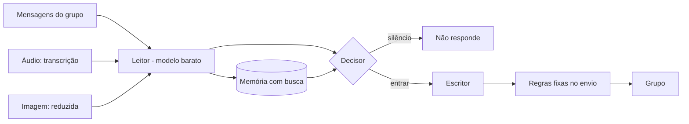

# Cutu: uma IA que participa de grupos de WhatsApp

Projeto pessoal. O Cutu entra no grupo como mais um participante: responde quando é chamado, comenta quando tem algo a dizer, lembra de conversas antigas e confere boato. O problema de engenharia mais interessante não é falar, e sim saber **quando ficar quieto**.

## Pipeline: leitor, decisor, escritor

Cada lote de mensagens passa por três papéis, e cada papel usa um modelo diferente, escolhido pelo que o papel exige:

- **Leitor**: passa o olho em todo lote, anota o assunto, o clima e o que um participante atento notaria. Roda sempre, então é o modelo mais barato. Quando há imagem, usa uma variante com visão.
- **Decisor**: escolhe se entra, em qual mensagem e com qual ação. É a etapa que mais pesa na qualidade percebida.
- **Escritor**: só escreve o que vai para o grupo, na voz configurada.

Separar os papéis permite trocar um modelo sem mexer nos outros e medir o custo de cada etapa.

## Silêncio como feature

Um bot que responde a tudo cansa o grupo em um dia. O Cutu tem cota de interações, horário silencioso, ritmo configurável e um decisor que pode escolher não fazer nada. No humor, o pipeline gera candidatas e um segundo modelo as compara; se nenhuma passa, **o resultado é ficar quieto, sem nova tentativa**. Candidata que não se apoia em uma mensagem real do contexto é descartada antes de chegar ao juiz. Ficar calado é um desfecho de primeira classe, com custo zero de IA no escritor.

## Memória com busca

O histórico do grupo é guardado e indexado. Perguntas do tipo "quando a gente falou de viagem?" são resolvidas por busca na memória, **sem chamar modelo**; o modelo só entra para resumir quando há mais de um trecho, e o resumo só vale se citar as datas dos trechos. Onde dá, o determinístico ganha do generativo.

## Áudio e visão

Áudio é transcrito (Whisper quando há chave; senão, um modelo multimodal) e entra no fluxo como texto. Imagem é reduzida e vista apenas pelo leitor; o decisor e o escritor recebem só o texto. O arquivo não é guardado depois do uso.

## Fallback entre provedores

A chamada percorre uma cadeia de provedores e, dentro do roteador, cada papel tem um modelo de reserva. Falha de provedor ou resposta inválida não derruba o grupo: troca de modelo, repete e, no pior caso, volta ao texto fixo.

## Avaliação com juiz cego

Trocar modelo por preço sem medir qualidade é apostar. A parte aberta dessa avaliação, comparando modelos por papel com juiz cego, está em [llm-roles-eval](https://github.com/jhuan-montoya/llm-roles-eval).

## Custo real

Medido em produção, com o custo informado pelo provedor de roteamento:

- cerca de **US$ 0,15 por mil mensagens** em um grupo bem ativo;
- texto responde por 96% do gasto, imagem gerada por 3% e áudio por 1%;
- trocar a ordem fixa de provedor por roteamento por preço **reduziu o custo por chamada em cerca de 4x**, sem mudar de modelo.

A lição: a maior economia veio de roteamento, não de prompt. A próxima, trocar os modelos de decisor e escritor por opções menores, só entra depois de passar pela avaliação.

## Números de engenharia

- ≈ 13 mil linhas de código no bot;
- ≈ 15,5 mil linhas de testes, em 71 arquivos de teste;
- suíte com limite de tempo por teste, para travamento virar falha e não suíte pendurada.

---

*Produto próprio; código fechado.*
